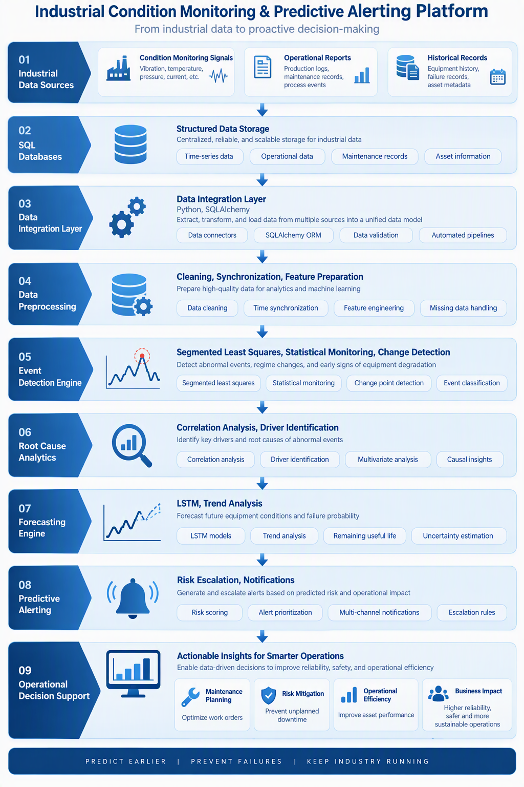
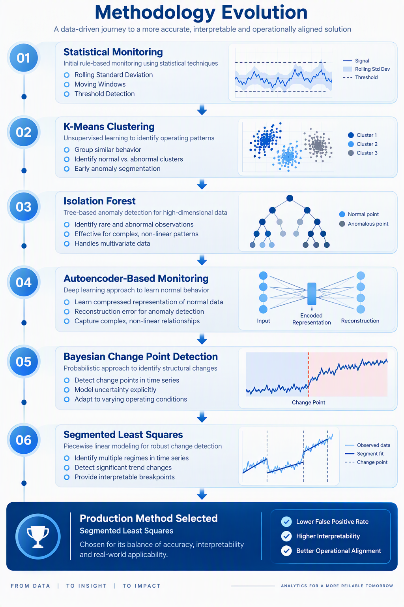
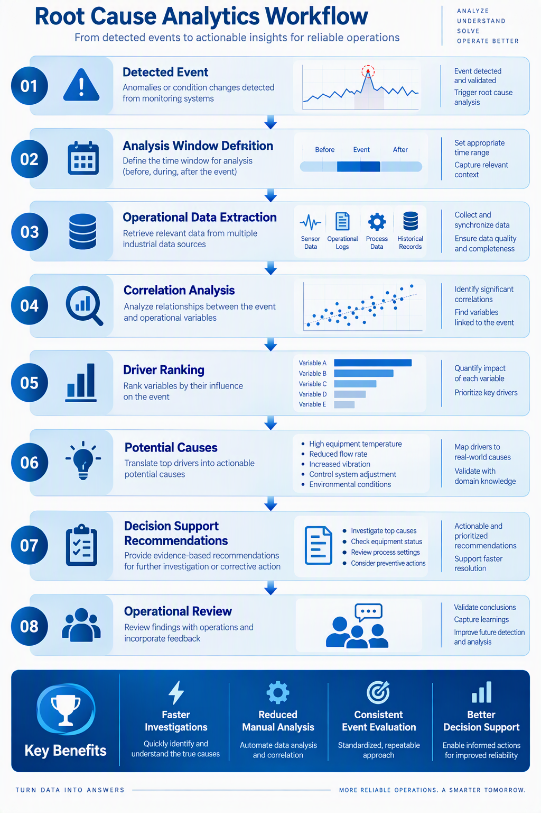
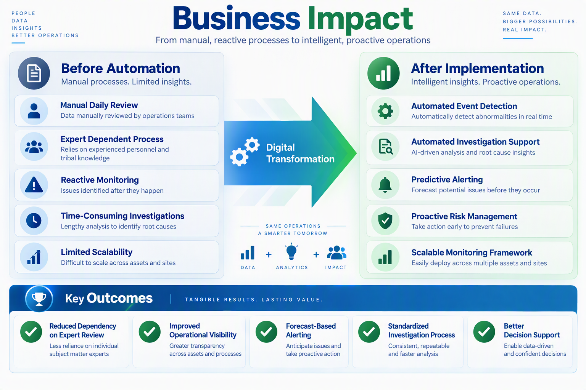

# Automated Industrial Event Detection and Predictive Alerting System

Industrial condition monitoring, event detection, root-cause analytics, and predictive alerting platform designed to support proactive operational decision-making in industrial environments.

---

## Project Overview

This project was developed to automate industrial condition monitoring processes that previously relied on manual expert review.

The platform integrates condition-monitoring signals, operational process data, event detection mechanisms, forecasting models, and root-cause analytics to identify abnormal behavior, investigate potential causes, and generate proactive alerts.

The objective was not only to detect abnormal conditions but also to support operational decision-making through automated investigation and early warning capabilities.

---

## Business Problem

Industrial condition monitoring often depends on highly specialized personnel reviewing operational and condition-monitoring data on a daily basis.

This approach can lead to:

- High dependency on expert knowledge
- Significant manual effort
- Delayed event detection
- Limited scalability
- Reactive maintenance decisions

The goal of this project was to automate the monitoring and investigation process while preserving analytical accuracy and operational relevance.

---

## Solution Overview

The solution integrates multiple layers of analytics:

1. Continuous condition monitoring
2. Event detection
3. Event prioritization
4. Root-cause investigation
5. Forecasting and trend analysis
6. Predictive alerting
7. Decision support

The resulting framework provides both real-time and forward-looking visibility of equipment-condition evolution.

---

## Solution Architecture



```text
Industrial Data Sources
          │
          ▼
SQL Databases
          │
          ▼
Python / SQLAlchemy
          │
          ▼
Data Preprocessing
          │
          ▼
Event Detection Engine
          │
          ▼
Root Cause Analytics
          │
          ▼
Forecasting Engine
          │
          ▼
Predictive Alerting
          │
          ▼
Operational Decision Support
```

---

## Methodology Evolution

One of the most valuable aspects of this project was the systematic evaluation of multiple analytical approaches before selecting the final production methodology.

Rather than relying on a single technique, several statistical, machine learning, deep learning, and change-point detection methods were explored and evaluated based on detection quality, false-positive rate, interpretability, and operational usefulness.

### Evaluated Approaches

#### Statistical Monitoring

- Rolling Standard Deviation
- Moving Windows
- Threshold-Based Detection

#### Clustering-Based Detection

- K-Means Clustering
- PCA-Based Analysis

#### Anomaly Detection

- Isolation Forest

#### Deep Learning

- Autoencoder-Based Multivariate Monitoring

#### Change Point Detection

- Bayesian Change Point Detection

#### Structural Change Detection

- Segmented Least Squares (SLS)

After extensive evaluation, Segmented Least Squares was ultimately selected due to its superior interpretability, lower false-positive rate, and stronger alignment with industrial root-cause investigation workflows.

---

## Methodology Evolution Diagram



```text
Statistical Monitoring
        ↓
K-Means
        ↓
Isolation Forest
        ↓
Autoencoders
        ↓
Bayesian Change Point Detection
        ↓
Segmented Least Squares
```

---

## Event Detection Framework

The platform continuously monitors condition indicators and identifies significant structural changes in system behavior.

Unlike traditional anomaly detection approaches focused on individual outliers, the selected methodology was designed to identify meaningful behavioral shifts that may indicate evolving operational issues.

Detected events are automatically:

- Identified
- Timestamped
- Prioritized
- Forwarded for automated investigation

This approach significantly reduced the need for manual daily monitoring while improving consistency across investigations.

---

## Root Cause Analytics

Once an event is detected, the platform automatically initiates an investigation process to determine which operational conditions may have contributed to the observed behavior.

The investigation workflow includes:

1. Event identification
2. Analysis-window determination
3. Operational data extraction
4. Correlation analysis
5. Driver ranking
6. Root-cause exploration
7. Decision-support recommendations

By automatically narrowing the investigation scope, the platform helps engineers and analysts focus on the most relevant operational factors.

---

## Root Cause Investigation Workflow



```text
Detected Event
      ↓
Analysis Window
      ↓
Operational Data Extraction
      ↓
Correlation Analysis
      ↓
Driver Ranking
      ↓
Potential Causes
      ↓
Decision Support
```

---

## Forecasting and Trend Analysis

To support proactive maintenance and operational planning, forecasting capabilities were incorporated into the platform.

The objective was not only to understand current conditions but also to anticipate future trends before critical thresholds were reached.

### Models Evaluated

- Statistical Trend Analysis
- XGBoost
- LSTM Neural Networks
- Bidirectional LSTM Networks

LSTM-based architectures provided the best overall performance for capturing long-term temporal dependencies and were selected for deployment.

### Forecast Horizons

#### Long-Term Risk Anticipation

Developed to identify potential condition-related risks well before they became operational concerns.

- 6 Months
- 12 Months

#### Short-Term Trend Monitoring

Designed for continuous operational follow-up and trend evaluation.

- 30 Days
- 60 Days
- 90 Days

---

## Predictive Alerting

The forecasting system was connected to an automated alerting framework capable of notifying stakeholders when projected conditions indicated elevated operational risk.

### Alerting Logic

Forecasted conditions were continuously compared against predefined operational limits.

Alerts were generated when:

- Projected values exceeded acceptable thresholds
- Significant trend changes were detected
- Risk conditions persisted over time

### Alert Fatigue Prevention

To avoid generating duplicate reports, forecast consistency checks were implemented.

New alerts were only issued when meaningful forecast changes were observed, helping reduce alert fatigue while maintaining visibility of critical conditions.

### Escalation Process

The system supported progressive escalation when a risk condition g attention without overwhelming end users with unnecessary notifications.

---

## Technologies Used

### Programming

- Python
- SQL

### Data Engineering

- SQLAlchemy
- Pandas
- NumPy
- Databricks

### Machine Learning & Forecasting

- Scikit-Learn
- TensorFlow
- Keras
- XGBoost
- LSTM Networks

### Analytics

- Statistical Modeling
- Time Series Analysis
- Forecasting
- Root Cause Analytics
- Change Point Detection

### Visualization

- Power BI
- Matplotlib
- Seaborn

---

## Results and Business Impact

The platform transformed a highly manual monitoring process into an automated and scalable analytical workflow.

### Key Outcomes

✅ Automated event detection

✅ Automated investigation support

✅ Reduced dependency on manual expert review

✅ Improved operational visibility

✅ Enabled proactive maintenance decisions

✅ Implemented predictive alerting capabilities

✅ Increased scalability across monitored assets

### Business Impact

Before implementation, subject matter experts were required to manually review monitored conditions on a daily basis.

After deployment, much of the monitoring, investigation, and alert-generation process was automated, allowing specialists to focus on high-value investigations and decision-making activities rather than routine review tasks.

The result was a more scalable, consistent, and proactive approach to industrial condition monitoring.

## Business Impact



---

## Confidentiality Notice

This repository presents the analytical architecture, methodologies, and technical approach of the project.

To protect intellectual property and client confidentiality:

- Operational datasets have been removed
- Client-specific information has been anonymized
- Proprietary prioritization frameworks are not included
- Proprietary recommendation engines are not included
- Internal thresholds and business rules have been omitted
- Deployment-specific configurations have been removed

This repository is intended to showcase the analytical design and engineering approach behind the solution.

---

## Future Improvements

Potential future developments include:

- Real-Time Streaming Analytics
- Explainable AI Modules
- Advanced Multivariate Forecasting
- MLOps Deployment Pipelines
- Graph-Based Root Cause Analysis
- Generative AI-Assisted Investigations

---

## Author

Marco Arciba

**Senior Data Scientist | Forecasting & Advanced Analytics | AI & Business Intelligence**

*Turning Data into Business Decisions*
